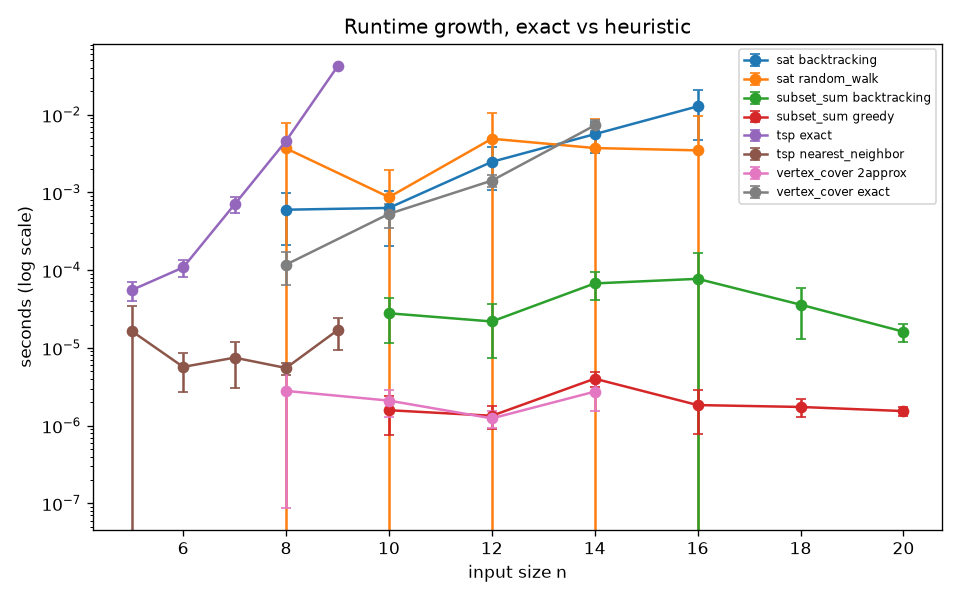
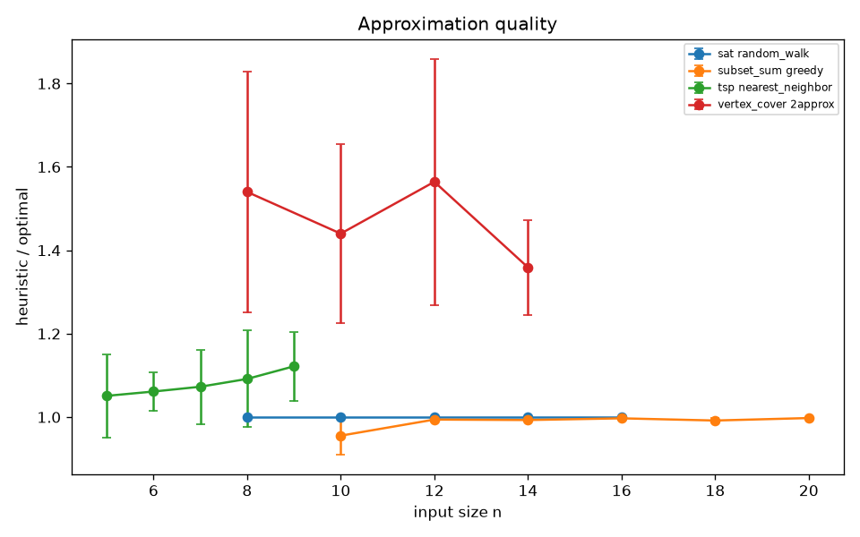
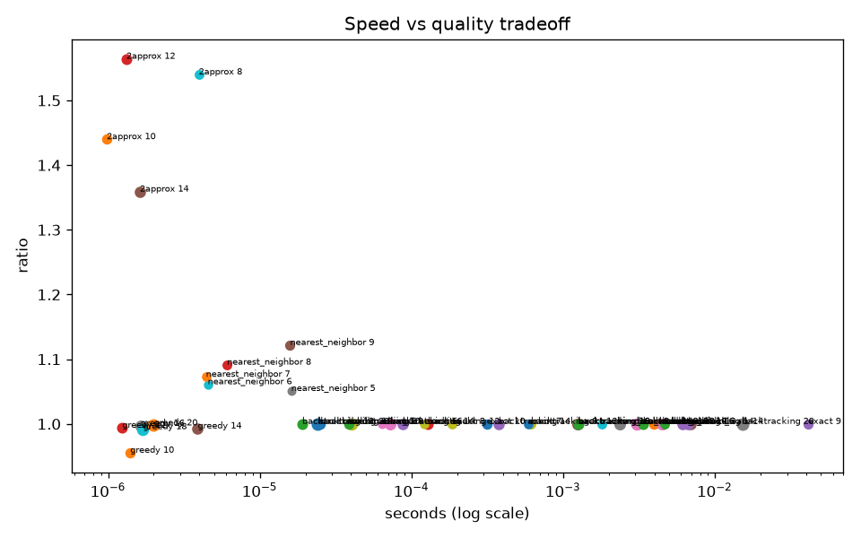

# Week 8 Technical Report: Computational Complexity

Omar Vasquez
Concordia University Texas MCS
CSC 5300 Advanced Algorithms
October 2026

## Executive Summary

This week I built five pieces in Python: a 3-SAT to Vertex Cover reduction, a backtracking Subset Sum solver with a greedy heuristic, a backtracking SAT solver with a random walk heuristic, a 2-approximation for Vertex Cover, and Nearest Neighbor for TSP. Each exact solver ran against its fast heuristic on growing inputs.

The exact solvers blew up, just like the theory says. TSP exact went from 0.0047 s at 8 cities to 0.041 s at 9 cities. One extra city cost almost 9 times more time. Subset Sum with no answer went from 0.000038 s at n = 10 to 0.0152 s at n = 20, about 396 times slower. The heuristics stayed in the microseconds the whole time, and most of them landed pretty close to the best answer.

The surprise was Subset Sum when an answer exists. It stayed flat.

## Methodology

I ran everything on my Windows PC with Python 3.14.7.

**Seeds and trials.** The seed is 5300, set in `src/utils/rng.py`. One seeded random generator builds every input, so a rerun makes the exact same data. Each size got 5 trials, and each trial was a new random input from that generator. I timed each call once with `time.perf_counter` and saved the mean and the sample standard deviation across the 5 trials. Dr. A asked us to report spread, so every number below has its std next to it.

**Inputs.**
- Subset Sum: n = 10 to 20 random integers from 1 to 1,000. The target is the sum of a random half of the list, so an answer always exists.
- Subset Sum worst case: n = 10 to 20 even numbers, with an odd target near half the total. No subset can ever hit it.
- SAT: 8 to 16 variables, random 3-CNF with 4.26 clauses per variable. That ratio is known as the hardest spot for random 3-SAT.
- Vertex Cover: random graphs with 8 to 14 nodes and edge chance 0.4.
- TSP: 5 to 9 random points in a 100 by 100 square.

**Quality metric.** For Vertex Cover and TSP, the ratio is heuristic answer divided by the exact answer, so 1.0 is perfect and higher is worse. For Subset Sum greedy, it is greedy's total divided by the target. For SAT, it is 1 if the random walk found a solution whenever one existed, and 0 if it missed.

## Results

The runtime chart uses a log scale. A straight line going up on a log scale means exponential growth. TSP exact and Subset Sum worst case climb the steepest. The heuristics sit near the bottom and barely move.

| Problem | Algorithm | Small n: mean (std) s | Large n: mean (std) s | Growth |
|---|---|---|---|---|
| TSP | exact | n=8: 0.0047 (0.0003) | n=9: 0.0412 (0.0003) | about 9x |
| TSP | nearest neighbor | n=5: 0.000016 (0.000017) | n=9: 0.000016 (0.000009) | flat |
| Vertex Cover | exact | n=8: 0.00019 (0.00004) | n=14: 0.0067 (0.0022) | about 36x |
| Vertex Cover | 2-approx | n=8: 0.000004 (0.000002) | n=14: 0.0000016 (0.0000009) | flat |
| SAT | backtracking | n=8: 0.00061 (0.00031) | n=14: 0.0061 (0.0031) | about 10x |
| Subset Sum | backtracking (solvable) | n=10: 0.000025 (0.000014) | n=20: 0.000024 (0.000023) | flat |
| Subset Sum | backtracking (no answer) | n=10: 0.000038 (0.000012) | n=20: 0.0152 (0.0063) | about 396x |

**TSP.** This was the cleanest result. Exact checks every possible tour, which is factorial. Going from 8 to 9 cities should cost about 8 or 9 times more, and I measured about 8.8 times.

**Vertex Cover.** Exact went from 0.00019 s at 8 nodes to 0.0067 s at 14. That is about 36 times slower for 6 more nodes.

**SAT.** Backtracking grew about 10 times from 8 to 14 variables, from 0.00061 s to 0.0061 s. Then at 16 variables it dropped to 0.0045 s. I think that is just luck in which formulas got drawn. The std at 16 was 0.0036 s, almost as big as the mean, so one easy or hard formula moves the whole average. The random walk found a solution every single time one existed.

**Subset Sum.** Solvable Subset Sum stayed around 0.00002 to 0.00009 s at every size. The worst case is where the exponential shows up. Every +2 numbers made it about 2.5 to 5 times slower, and 10 more numbers made it about 396 times slower. A full 2 to the n search would be 1,024 times, so my pruning still cuts a lot, but the curve clearly explodes.

| Heuristic | Ratio range across sizes (mean) | Largest std |
|---|---|---|
| TSP nearest neighbor | 1.05 to 1.12 | 0.12 |
| Vertex Cover 2-approx | 1.36 to 1.56 | 0.30 |
| Subset Sum greedy | 0.956 to 0.998 of target | 0.045 |
| SAT random walk | 1.0 at every size | 0.0 |

Nearest Neighbor tours were 5 to 12 percent longer than the best tour, and the gap grew a little as n grew. The Vertex Cover 2-approximation was worse, with covers 1.36 to 1.56 times the best size, but it never went over its proven limit of 2. Greedy Subset Sum landed between 0.2 and 4.4 percent short of the target.

The tradeoff chart puts it all on one picture. The exact solvers sit at ratio 1.0 but slide far to the right as n grows. The heuristics stay on the left, fast, and pay for it with a ratio a bit above 1.

## Discussion

**P and NP.** P is the set of problems we can solve in polynomial time, like n squared or n cubed. NP is the set of problems where, if someone hands you an answer, you can check it in polynomial time. For Subset Sum, checking is easy: add up the numbers. Finding them is the hard part. NP-hard means a problem is at least as hard as everything in NP. NP-complete means it is NP-hard and also in NP. SAT, Subset Sum, Vertex Cover, and the decision version of TSP are all NP-complete.

P vs NP asks if every problem that is easy to check is also easy to solve. Nobody knows. Nobody has found a polynomial algorithm for any NP-complete problem, and nobody has proven one can't exist. If someone found one, every NP problem would become easy at once, because they all reduce to each other.

**The reduction.** My `reduce_3sat_to_vc` turns a 3-SAT formula into a graph. Each variable gets two dots, `x1` and `~x1`, joined by a line, so a cover has to pick at least one. That pick is the true or false choice. Each clause gets a triangle, and a cover needs 2 of its 3 corners. Each corner links to the variable dot it stands for. Then k = n + 2m, where n is variables and m is clauses. The formula is satisfiable exactly when the graph has a cover of size k. My tests check this both ways, and `cover_from_assignment` builds the cover straight from a true/false setting.

The reduction is polynomial because it only makes 2n + 3m dots and n + 6m lines, and each one takes constant work. So if Vertex Cover had a fast solver, 3-SAT would too. That is why Vertex Cover is NP-hard.

**Why the curves explode.** Adding one item to an exponential problem multiplies the work, it doesn't add to it. TSP shows it best. My exact solver keeps city 0 fixed and tries every order of the rest, so going from 8 to 9 cities multiplied the tours by 8. That is why the heuristics stayed flat on the log chart while the exact lines kept climbing.

**Why approximations matter.** The 2-approximation has a real guarantee. It picks both ends of an uncovered edge, and any cover needs at least one of those ends, so it can never be more than 2 times the best. Nearest Neighbor has no constant guarantee in general, but on my random points it stayed within 12 percent.

## Limitations

- **Small n.** The exact solvers limited my sizes to 9 cities and 14 nodes. That is enough to see the trend but not to fit a clean curve.
- **Python timing noise.** Many timings are in the microseconds, where the OS and Python itself add noise. Some std values are as big as the mean, for example solvable Subset Sum at n = 16 (0.000073 s mean, 0.000088 s std). I timed each trial only once.
- **How the Subset Sum target is built.** The solvable target is always a real subset, so backtracking finds it early and stops. That is why it looked flat. I added the no-answer worst case to show the real 2 to the n behavior.
- **SAT metric.** The random walk score only says it found a solution when one existed. With 5 trials per size, that is a small sample, and it doesn't show how close it came when it missed.
- **One machine and one seed.** Everything came from seed 5300 on my PC. Another seed would draw different inputs.

## Conclusion

This project showed that knowing a problem is NP-complete should shape how you choose an algorithm. For small inputs, an exact solver is practical and gives the best answer. As inputs grow, exact runtimes grow exponentially, as my TSP and worst-case Subset Sum results showed, so a heuristic with a measured quality ratio becomes the better choice. The Subset Sum results also showed that the same code can behave very differently in its typical case and its worst case, so testing both matters.

In future work, I would time each trial several times and report the median, and repeat the benchmarks across more seeds to get more reliable results.

## References

Amakobe, M. (2026). *Advanced computational algorithms: Concepts, complexity, and applied projects* (2nd ed.). GDSI Press. https://proff-amakobe.github.io/oer-books/advanced-algorithms-book/ (Chapter 7, sections 7.3 to 7.6, and Chapter 8, section 8.2)
